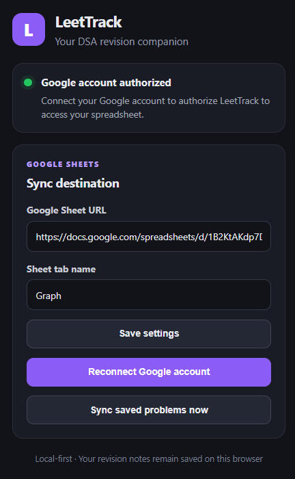
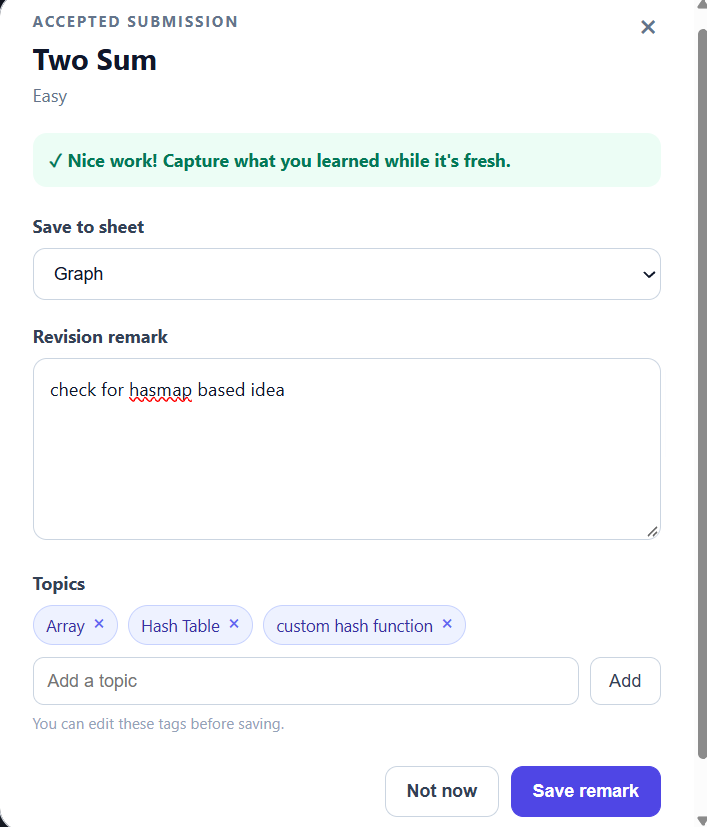
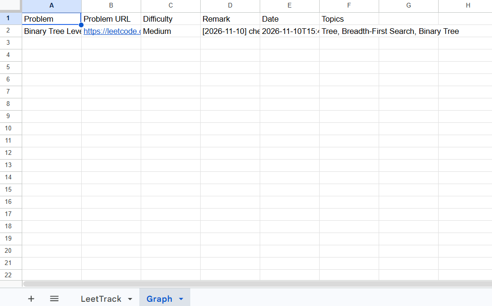
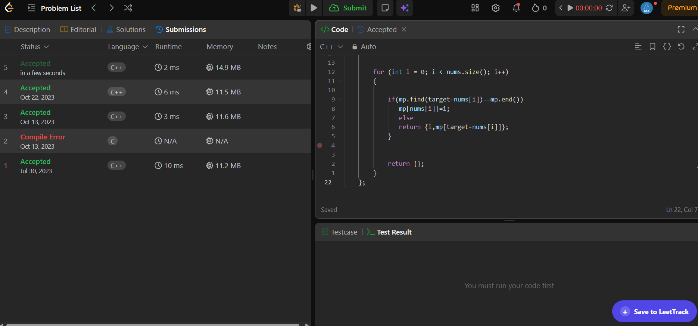

# LeetTrack

**A Chrome extension that turns accepted LeetCode submissions into a personal DSA revision log.**

LeetCode tracks what you solve. LeetTrack helps you remember **how you solved it, what you learned, and what to revisit**. It captures accepted submissions (or lets you save a problem manually), collects revision notes and topics, and syncs your records to your own Google Spreadsheet.

## Why LeetTrack?

Solved-problem counts don't preserve the reasoning behind a solution. Notes are often scattered or forgotten, making revision harder. LeetTrack keeps each problem and its revision history together, so you can return to your previous mistakes, insights, and approaches.

## Features

- **Automatic & manual capture** of LeetCode problems.
- **Revision history** with dated notes; previous notes and the original solve date are preserved.
- **Problem metadata** including title, URL, difficulty, and editable topics.
- **Google Sheets sync** directly to a spreadsheet you choose, without a hosted LeetTrack backend.
- **Per-problem tab assignment** so revisions stay with the problem's original spreadsheet tab.
- **Duplicate protection** for already-processed submissions.

## How it works

1. Solve a problem and get an Accepted result, or use the manual **Save to LeetTrack** button.
2. Add a remark about your approach, mistake, insight, or what to revise.
3. Review topics and choose a spreadsheet tab for a new problem.
4. Save. LeetTrack stores the record locally and syncs it to Google Sheets.
5. Revisit the problem later; new remarks are appended to the same record.

## Screenshots

### LeetTrack extension popup
View your Google account connection, configure the destination spreadsheet, and manually sync saved problems.

### Capture a problem and add a revision note
After an Accepted submission, review the problem details, add a remark, edit topics, and select the spreadsheet tab.

### Revision records in Google Sheets
Keep problem details, dated remarks, original solve dates, and topics organized in your own spreadsheet.

### Manual capture on a LeetCode problem
Capture a problem directly from its LeetCode page without waiting for a new Accepted submission.

## Tech stack

TypeScript · React · Chrome Extension APIs (Manifest V3) · Google OAuth 2.0 · Google Sheets API · Vite

## Get started

For prerequisites, Google Cloud/OAuth configuration, build commands, installation, data format, architecture, troubleshooting, and known limitations, see the **[Setup & Documentation Guide](docs/SETUP.md)**.

## Project links

- [Source code](https://github.com/pmmaster12/leettrack)
- [Report a bug / request a feature](https://github.com/pmmaster12/leettrack/issues)
- [Privacy policy](docs/privacy-policy.md)

**Release:** v0.2.0 — Chrome Web Store review pending.

## License

This project is licensed under the MIT License.
See the [LICENSE](LICENSE) file for details.
